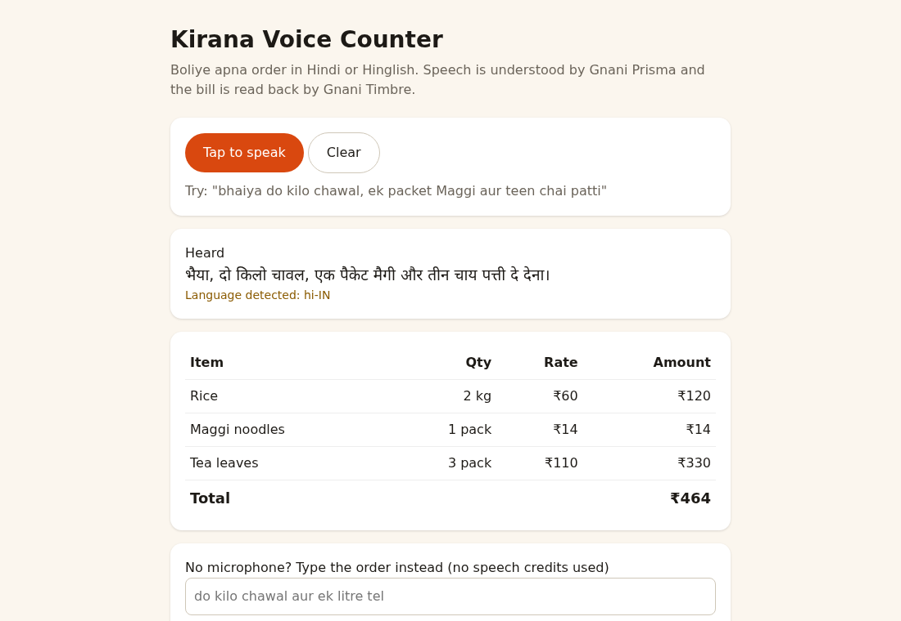

# Kirana Voice Counter

Speak a grocery order in Hindi or Hinglish. The app turns it into an itemised bill and reads it back.
Built for the Great Indian AI Internship Challenge (solo entry) on two Gnani AI models:

- **Prisma v3.0** (speech to text, REST `https://api.vachana.ai/stt/v3`) transcribes the order.
- **Timbre v2.5** (text to speech, REST `https://api.vachana.ai/api/v1/tts/inference`) reads the bill back.

Demo video: [kirana_demo.mp4](kirana_demo.mp4) (about 2 minutes 10 seconds).



## How it works

1. The browser records the order (MediaRecorder).
2. `app.py` converts it to 16 kHz mono WAV with ffmpeg and sends it to Prisma.
3. `kirana.py` reads the transcript (Devanagari or Latin) with a rule based parser: Hindi number words
   (ek, do, teen, dedh, dhai, aadha), units (kilo, gram, litre, packet, dozen) and 14 catalogue items.
4. The bill is shown, and a short Hinglish summary is sent to Timbre and played back.

## Run it

```
pip install requests
export GNANI_API_KEY=...        # create one at https://app.gnani.ai
python app.py                   # needs ffmpeg on PATH; open http://localhost:8000
python -m unittest              # 8 parser tests, no API calls
python e2e_demo.py              # Timbre speaks an order, Prisma transcribes it, bill + read-back (about 8 API calls)
```

No API key is stored in this repository. The key is read from the `GNANI_API_KEY` environment variable only.

## Honest limits

- Prices and the 14 items are sample data, not a real shop's.
- The parser is rules, not a language model. Items it does not know are listed as "not in catalogue", not guessed.
- In testing Prisma once heard "dedh kilo cheeni" as "de do kilo chini", which gave 2 kg instead of 1.5 kg. No accuracy claim is made.
- All audio used in the demo video is synthetic (generated with Timbre), played into Chrome as a fake microphone.
  Everything after the microphone is the real pipeline. It was not tested with real shop noise or real speakers.
- Built with the help of an AI assistant working for the author.

## Files

`app.py` server, `gnani.py` API client, `kirana.py` parser and bill, `index.html` UI, `test_kirana.py` tests,
`e2e_demo.py` API end to end check, `record_demo.py` and `build_video.py` how the demo video was made,
`demo_result.json` output of the end to end check.
